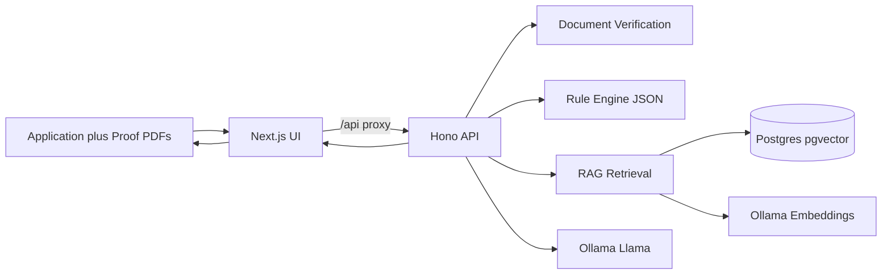

# Loan Eligibility RAG App

A TypeScript app that checks whether a loan applicant **fits company guidelines**.

Someone can send an **application** plus **proof documents** (payslip, bank statement, employment certificate). The app:

1. **Verifies** proofs are related to repayment capacity and match claimed income/name
2. Runs **configurable rules** (FIT / NOT FIT)
3. Finds relevant policy text with **cosine similarity** (RAG)
4. Optionally asks a small local **Llama** model to explain

Stack: **Next.js + shadcn** UI · **Hono** API (`apps/ts`) or **FastAPI** API (`apps/python`) · **PostgreSQL/pgvector** · **Ollama** (`llama3.2:1b`, `nomic-embed-text`).

In-app walkthrough with GIF: [http://localhost:3000/docs](http://localhost:3000/docs) (after start).

**Share with colleagues (Notion-ready):** copy [`docs/NOTION-SHARE.md`](docs/NOTION-SHARE.md) into Notion.  
**How the prototype works (non-technical):** [`docs/HOW-RAG-WORKS.md`](docs/HOW-RAG-WORKS.md).

---

## Architecture (simple overview)

Think of the system as boxes working together:



| Part | What it does | Where it lives |
|------|----------------|----------------|
| **UI** | Form + document upload, FIT / NOT FIT | `apps/web/` (Next.js) |
| **Shared UI kit** | shadcn components, `cn()`, theme CSS | `packages/ui/` (`@workspace/ui`) |
| **Demo docs** | How it works + GIF walkthrough | `apps/web/src/app/docs`, `apps/web/public/demo.gif` |
| **API (TypeScript)** | Receives application + proofs | `apps/ts/src/routes/`, `apps/ts/src/loan/` (port 3001) |
| **API (Python)** | Same API as a FastAPI port | `apps/python/app/` (port 8000) |
| **Document verification** | Is it a payslip/bank/COE? Name & income match? | `apps/ts/src/loan/verifyProofDocuments.ts` |
| **Rule engine** | Hard checks (age, income, tenure, DTI…) | `data/rules/loan-rules.json` |
| **RAG** | Finds matching guideline paragraphs | `apps/ts/src/rag/` + Postgres |
| **LLM** | Short explanation from retrieved text | Ollama `llama3.2:1b` |
| **Guidelines** | Company policy docs (MD/PDF) | `data/guidelines/` |

### What happens when someone applies

1. Applicant submits an **application** (form or PDF) plus **proof documents** (payslip, bank statement, employment certificate).
2. **Document verification** checks each proof is related to repayment capacity and matches claimed income/name.
3. **Rule engine** reads `loan-rules.json` and decides base FIT / NOT FIT.
4. **RAG** finds the closest guideline chunks with **cosine similarity**.
5. Those chunks go to **Llama** for an optional AI view.
6. Final FIT requires **rules pass + proof docs pass** (when verification is required).

```text
Application PDF + Proof PDFs (payslip / bank / COE)
    │
    ├─► Document verification ──► related to capacity? name/income match?
    ├─► Rules JSON  ──► base FIT / NOT FIT
    │
    └─► Embed query ──► Cosine search in Postgres ──► Top policy chunks
                                                      │
                                                      └─► Llama explanation

Final FIT = rules pass AND proof documents pass
```

Docker runs **web** (Next.js :3000), **api** (Hono :3001), **postgres** (pgvector), and **ollama**.

---

## How we decide FIT or NOT FIT (simple)

You can think of it like a **checklist**, not a chat with AI.

### The final answer

```text
FIT  =  rules pass  AND  proof documents pass
```

If either part fails → **NOT FIT**.

The AI may give its own opinion on the results screen, but it does **not** decide the final FIT / NOT FIT.

### Gate 1 — Rules (the numbers)

The app reads thresholds from [`data/rules/loan-rules.json`](data/rules/loan-rules.json) and checks things like:

- Age in range?
- Job type allowed?
- Worked long enough for this loan size?
- Income high enough for the amount requested?
- Loan size and term within limits?
- Monthly payment affordable?
- Credit score OK?
- Debt not too high compared to income?

**All** of these must pass. If one fails, the person is NOT FIT for the rules gate.

Same numbers in → same answer out. No guessing.

### Gate 2 — Proof documents (the papers)

When someone uploads proofs (payslip, bank statement, or employment certificate), the app checks:

1. Is this a real capacity-related document (not a random bill)?
2. Does the **name** match the applicant?
3. Does the **income** on the document roughly match what they claimed? (within a tolerance, e.g. 15%)

If proofs are required and they fail these checks → NOT FIT, even if the numbers alone looked fine.

### What the AI is for

1. Find the closest company guideline paragraphs (cosine similarity / RAG).
2. Ask a small local Llama model to comment using only that text.

That is for **explanation**. The green/red FIT banner always follows the two gates above.

### Tiny example

| Situation | Result |
|-----------|--------|
| Age, income, credit all OK + matching payslip | **FIT** |
| Everything OK on the form, but payslip has a different name | **NOT FIT** |
| Matching payslip, but income too low for the loan amount | **NOT FIT** |
| Rules and docs pass, but AI says “maybe not” | Still **FIT** (AI does not override) |

---

## How cosine similarity works here

### Plain English

An **embedding** is a list of numbers that represents the meaning of a piece of text.

- Similar meanings → vectors point in a **similar direction**
- Different meanings → vectors point in **different directions**

**Cosine similarity** measures how close those directions are:

- `1.0` = almost the same meaning
- `0.0` = unrelated
- lower / negative = opposite directions

So if the applicant text is about “low credit score and high debt”, cosine search pulls guideline chunks about credit bands and DTI — not random paragraphs.

### Step by step in this app

1. **Ingest (startup)**  
   Guidelines in `data/guidelines/` are split into short chunks and embedded with Ollama `nomic-embed-text` (768 numbers each).  
   Stored in Postgres table `guideline_chunks.embedding` (`vector(768)`).

2. **On each eligibility check**  
   The app builds a short query from the applicant (income, employment, loan amount, etc.) in [`apps/ts/src/rag/retriever.ts`](apps/ts/src/rag/retriever.ts), then embeds that query the same way.

3. **Rank by cosine in Postgres (production path)**  
   pgvector compares the query vector to every chunk:

```sql
ORDER BY embedding <=> $query_vector   -- cosine distance (smaller = closer)
LIMIT 3
```

   Score shown in the UI:

```text
score = 1 - cosine_distance
```

   Higher score = more similar. See [`apps/ts/src/rag/retriever.ts`](apps/ts/src/rag/retriever.ts).

4. **Hand-written formula (learning / tests)**  
   The same idea is implemented in TypeScript in [`apps/ts/src/rag/cosine.ts`](apps/ts/src/rag/cosine.ts):

```ts
// cosineSimilarity = (A · B) / (|A| * |B|)
dot = sum(a[i] * b[i])
score = dot / (length(a) * length(b))
```

   Production retrieval uses **Postgres pgvector** for speed and indexing; `cosine.ts` documents the math clearly.

### Tiny example

| Text A | Text B | Expected similarity |
|--------|--------|---------------------|
| “minimum monthly income 20000” | “income floor monthly income must be at least 20000” | **High** |
| “minimum monthly income 20000” | “loan term must be between 12 and 60 months” | **Lower** |

That ranking is what fills **Retrieved guidelines (cosine similarity)** on the results screen.

---

## Why this stack

| Piece | Choice | Why |
|--------|--------|-----|
| UI | **Next.js + shadcn** | Modern React UI |
| API | **Hono** | Typed, small backend |
| Validation | Zod | Typed request bodies |
| DB | **PostgreSQL + pgvector** | Store apps + vectors; cosine in SQL |
| Rules | JSON config | Change thresholds without code |
| LLM | Ollama `llama3.2:1b` | Local, low token cost |

---

## Demo docs

Open **[http://localhost:3000/docs](http://localhost:3000/docs)** for a plain-language walkthrough and an animated GIF of a rules check.

To re-record the GIF (UI must be running; API responses are mocked):

```bash
npm run record:demo -w web
```

---

## What you need running

The UI alone is not enough. These four pieces must be up:

| Piece | Port | Role |
|--------|------|------|
| **Postgres** (pgvector) | 5432 | Rules data + guideline embeddings |
| **Ollama** | 11434 | Embeddings + Llama explanation |
| **Hono API** | **3001** | Eligibility, docs verify, RAG |
| **Next.js UI** | **3000** | Form / uploads; proxies `/api` → API |

If the form fails, check `http://localhost:3001/api/health` first.

---

## Monorepo layout

npm workspaces, one `package-lock.json` at the root:

```text
apps/
  web/       Next.js UI (workspace "web")
  ts/        Hono API (workspace "api")
  python/    FastAPI API (not an npm workspace; see below)
packages/
  ui/        shared shadcn components + theme (workspace "@workspace/ui")
data/        guidelines + loan-rules.json (shared by both APIs)
testdata/    sample PDFs
```

Use shared components from any app:

```tsx
import { Button } from "@workspace/ui/components/button";
import { cn } from "@workspace/ui/lib/utils";
import "@workspace/ui/globals.css"; // once, in the root layout
```

A new Next.js app needs `"@workspace/ui": "*"` in its dependencies, `transpilePackages: ["@workspace/ui"]` in `next.config.ts`, and `export { default } from "@workspace/ui/postcss.config";` as its `postcss.config.mjs`. Tailwind already scans `apps/*/src`.

Add shadcn components from the app folder and the CLI puts them in `packages/ui`:

```bash
cd apps/web && npx shadcn@latest add dialog
```

Handy root scripts: `npm run dev` (Hono API + web), `npm run dev:py` (FastAPI + web), `npm run build`, `npm run typecheck`, `npm run lint`, `npm test`, `npm run test:py`.

---

## Quick start (Docker — everything)

```bash
docker compose up --build
```

Services: `web`, `api`, `postgres`, `ollama`, `ollama-init`.  
First run pulls models (may take several minutes).

- UI: [http://localhost:3000](http://localhost:3000)
- Demo docs: [http://localhost:3000/docs](http://localhost:3000/docs)
- API health: [http://localhost:3001/api/health](http://localhost:3001/api/health)

---

## Local run (recommended for development)

### 1. One-time setup

```bash
cp .env.example .env
npm install        # installs every workspace (apps/web, apps/ts, packages/ui) from the root
```

Run the `npm run ...` commands below from the repo root.

### 2. Start Postgres + pull Ollama models

```bash
npm run deps:up
```

This starts `postgres` + `ollama` via Docker and pulls `llama3.2:1b` + `nomic-embed-text`.

### 3. Start API + UI together

```bash
npm run dev
```

That runs:

- API on [http://localhost:3001](http://localhost:3001)
- UI on [http://localhost:3000](http://localhost:3000)

Open [http://localhost:3000](http://localhost:3000). Next.js proxies `/api/*` to the Hono API.

Or two terminals:

```bash
# Terminal A — API
npm run dev:api

# Terminal B — UI
npm run dev:web
```

A rules check can take several seconds while Ollama embeds and answers.

### Stop dependency containers

```bash
npm run deps:down
```

---

## Python FastAPI API (`apps/python`)

A FastAPI port of the Hono API with the same endpoints, request/response JSON (camelCase keys), rules file, and Postgres tables. Both backends share `data/` (guidelines + `loan-rules.json`) and `testdata/` at the repo root.

```text
apps/
  ts/       Hono + TypeScript API (original)
  python/   FastAPI + Python API (port)
    app/
      main.py        FastAPI app + startup (migrate, wait for Ollama, ingest)
      config.py      env config (same variables as the TS API; default PORT=8000)
      db.py          psycopg pool + migrations
      llm/           Ollama chat + judgment parsing
      rag/           chunker, cosine, embeddings, ingest, pgvector retrieval
      loan/          rules, proof classification/verification, PDF parsing, pipeline
      routes/        /api/health, /api/check-eligibility(-pdf), /api/assess-documents, /api/rules
    tests/           pytest suite (mirrors the TS tests)
```

Run locally (Python 3.11+):

```bash
npm run deps:up   # Postgres + Ollama (from the repo root)
cd apps/python
python3 -m venv .venv
.venv/bin/pip install -e ".[dev]"
.venv/bin/uvicorn app.main:app --reload --port 8000
```

- Swagger UI: [http://localhost:8000/docs](http://localhost:8000/docs)
- Health: [http://localhost:8000/api/health](http://localhost:8000/api/health)
- Run it together with the UI: `npm run dev:py` (from the repo root)

Tests (offline, no Postgres/Ollama needed):

```bash
cd apps/python && .venv/bin/pytest
```

Docker (opt-in profile):

```bash
docker compose --profile python up --build api-python
```

Run only one API against a fresh database at a time on first boot; both ingest guidelines when the vector table is empty.

---

## API

### `GET /api/health`

Service status + indexed chunk count.

### `POST /api/check-eligibility`

```json
{
  "fullName": "Jane Doe",
  "age": 32,
  "monthlyIncome": 45000,
  "employmentStatus": "employed",
  "monthsEmployed": 18,
  "loanAmount": 200000,
  "loanTermMonths": 36,
  "creditScore": 720,
  "existingDebt": 15000
}
```

Response includes `eligible`, `reasons`, `matched_rules`, `matchedChunks` (text + cosine scores), and optional `aiCheck`.

### Rules API

```bash
curl http://localhost:3000/api/rules
curl -X POST http://localhost:3000/api/rules/reload
curl -X PUT http://localhost:3000/api/rules \
  -H 'Content-Type: application/json' \
  -d @data/rules/loan-rules.json
```

---

## Guidelines (for RAG)

Place policy files in [`data/guidelines/`](data/guidelines/): `.md`, `.txt`, or `.pdf`.

Samples:

- [`loan-policy.md`](data/guidelines/loan-policy.md)
- [`loan-underwriting-guidelines.pdf`](data/guidelines/loan-underwriting-guidelines.pdf)

```bash
npm run generate:pdf -w api
```

Tip: Markdown and PDF can cover the same policy. Keep one active before ingest to avoid duplicate chunks.

## Configurable underwriting rules

FIT / NOT FIT comes from [`data/rules/loan-rules.json`](data/rules/loan-rules.json) (age, income bands, tenure, DTI, credit, etc.).

Edit the JSON — no code changes. It hot-reloads when the file changes.

Keep `data/guidelines/` in sync with this JSON when thresholds change:

- **JSON** → rule engine (main decision)
- **Guidelines** → RAG / cosine retrieval + LLM context

---

## PDF application upload (realtime fit)

### Assess with application + proof documents

Upload an application PDF **and** capacity proofs (payslip / bank statement / COE):

```bash
curl -F "application=@testdata/applications/eligible-jane-doe.pdf" \
  -F "proofs=@testdata/proofs/payslip-jane-doe.pdf" \
  http://localhost:3000/api/assess-documents
```

The API will:

1. Parse the application fields
2. Classify each proof (payslip / bank statement / employment certificate / unknown)
3. Check the document is **related to loan capacity** (not a random bill)
4. Match **name** and **income** to the application (tolerance in `loan-rules.json`)
5. Run underwriting rules + optional RAG

Sample proof PDFs:

```bash
npm run generate:proof-pdfs -w api
# or all fixtures:
npm run generate:testdata -w api
```

Full catalog of application + proof pairs: [`testdata/README.md`](testdata/README.md).

Configure verification under `documentVerification` in [`data/rules/loan-rules.json`](data/rules/loan-rules.json).

### Application PDF only (rules preview)

```bash
curl -F "file=@testdata/applications/eligible-jane-doe.pdf" \
  http://localhost:3000/api/check-eligibility-pdf
```

Sample applicant PDFs:

```bash
npm run generate:applicant-pdfs -w api
```

Files are in `testdata/applications/` (fit + not-fit cases).

---

## Test suite

```bash
cd apps/ts
npm run generate:applicant-pdfs
npm run generate:proof-pdfs
npm test                 # unit + integration
npm run test:unit        # pure logic (classify / extract / verify / rules)
npm run test:integration # PDF fixtures + HTTP /api/assess-documents
```

Integration tests set `ELIGIBILITY_OFFLINE=1` so they do not need Ollama or Postgres.

## Re-ingest guidelines

```bash
npm run ingest -w api
# or, for the Python API:
cd apps/python && .venv/bin/python -m app.rag.ingest
# or, in Docker:
docker compose exec api npm run ingest
```

Edit files under `data/guidelines/`, then re-ingest (CLI ingest truncates and re-embeds).
